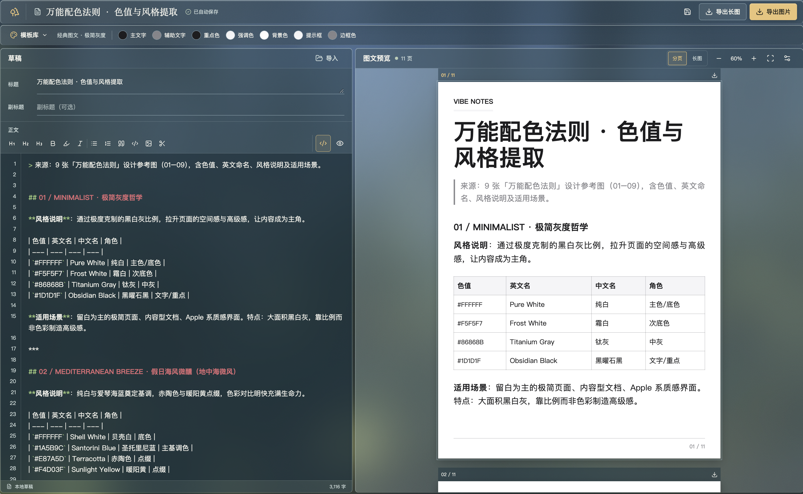

# visual-content-workbench· 图文笔记工作台
一个在浏览器中编辑、预览和导出图文笔记的工具，访问网址即可使用，不必下载代码或安装软件。草稿保存在使用者自己的浏览器中；支持的浏览器也可以选择本地工作目录。

## 产品预览




## 用户手册

1. 在首页点击「新建草稿」，用捕虫网捕捉萤火虫后进入编辑器；点击右下角的瓶子可打开「我的草稿」。从草稿箱新建草稿会直接进入编辑器。
2. 首次新建时选择保存位置：「选择本地工作目录」会将草稿同时写入所选文件夹和当前浏览器；「仅保存在浏览器」无需选择文件夹，但清除站点数据后草稿可能丢失。不支持选择目录的浏览器仍可使用浏览器存储。
3. 在编辑器左侧填写标题、副标题和正文。正文可在 Markdown 源码与富文本视图间切换，也可通过「导入」载入 Markdown、纯文本或本工具的草稿 JSON。
4. 在「模板库」切换主题或上传背景，使用颜色工具和排版设置调整样式。右侧可切换分页、长图预览，并调整缩放；正文过长时会自动分页，也可手动插入分页符。
5. 修改会自动保存；顶部保存图标可立即保存。点击「导出图片」下载全部分页的 ZIP，点击「导出长图」下载单张 PNG，也可下载某一页。分页图片为 1242 × 1660 像素。
6. 返回首页后，从瓶子打开草稿箱。点击气泡继续编辑；悬停可查看预览和删除按钮。删除草稿无法撤销；选择工作目录时，对应草稿文件也会被删除。

## 草稿与隐私

- 浏览器存储使用当前网站的 IndexedDB，不会自动同步到其他设备或网址。`localhost` 和线上网站也是两份独立的数据。清除站点数据、使用无痕窗口或更换浏览器，都可能导致浏览器内的草稿无法访问。
- 选择本地工作目录后，草稿还会以 `.rednote.json` 文件保存在该目录；以后重新选择同一目录，可读取其中的草稿。浏览器需要支持目录选择并获得读写权限。
- 顶部「保存草稿」是保存到当前存储位置，不是下载备份文件。需要长期留存时，建议使用本地工作目录并自行备份该目录。
- 应用不提供账户或云端草稿同步。导入远程图片会向图片所在网站发起请求；受跨域限制的图片可能无法提色或导出，建议直接上传本地图片。

## Markdown 编辑

支持标题、粗体、斜体、列表、引用、代码块、表格和图片。一级标题用作章节，二级标题用作小标题。独占一行的 `---` 或 `<!-- pagebreak -->` 表示手动分页。

同一段中的两张图片可并排展示，例如：

```md
 
```

提示词区域可写为：

````md
```prompt 布局规则
同类组件之间采用统一间距。
新增组件与相邻组件的边缘对齐。
```
````

普通代码块仍按代码展示。导入 Markdown 时，文件第一行的 `# 标题` 会填入标题栏。正文图片通过上传入口插入并保存在草稿中。

